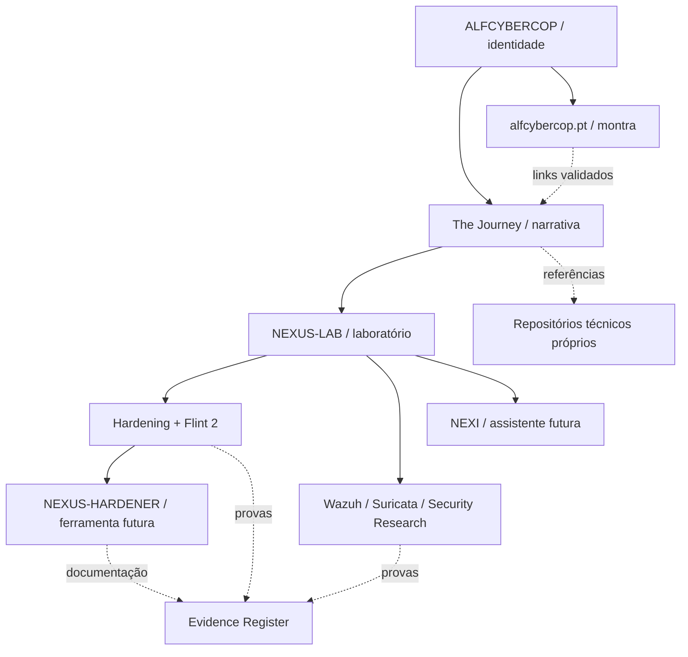

# Integrações — uma fonte, várias vistas

**Não criamos um monorepo de código que replique todos os projetos.** Este é o **repositório-mãe narrativo e de navegação**, que liga repositórios técnicos independentes, documentação e website.

## 5 camadas práticas

1. **Identidade pública:** perfil GitHub + `alfcybercop.pt`.
2. **Narrativa:** episódios que explicam *porquê* e a ordem dos factos.
3. **Projetos:** fichas técnicas e repositórios separados que explicam *como*.
4. **Evidência:** logs e prints **selecionados e sanitizados** que mostram *o que se comprovou*.
5. **Automação:** links, catálogo de projetos, verificadores e, futuramente, NEXI como interface.

## Política de ligações

- Não inventar links para repositórios só porque conhecemos o título.
- O Hardening já tem trabalho próprio; manter documentação original e relacioná-la com a história por link **após confirmar URL**.
- Não copiar ficheiros secretos/privados para este repositório.
- Novos projetos têm de indicar `estado`, `prova`, `limite` e `próxima validação`.

[Registo de URLs](LINK-REGISTRY.md) · [Catálogo estruturado](project-catalog.csv) · [Política de evidências](../EVIDENCE/PUBLICATION-POLICY.md)
