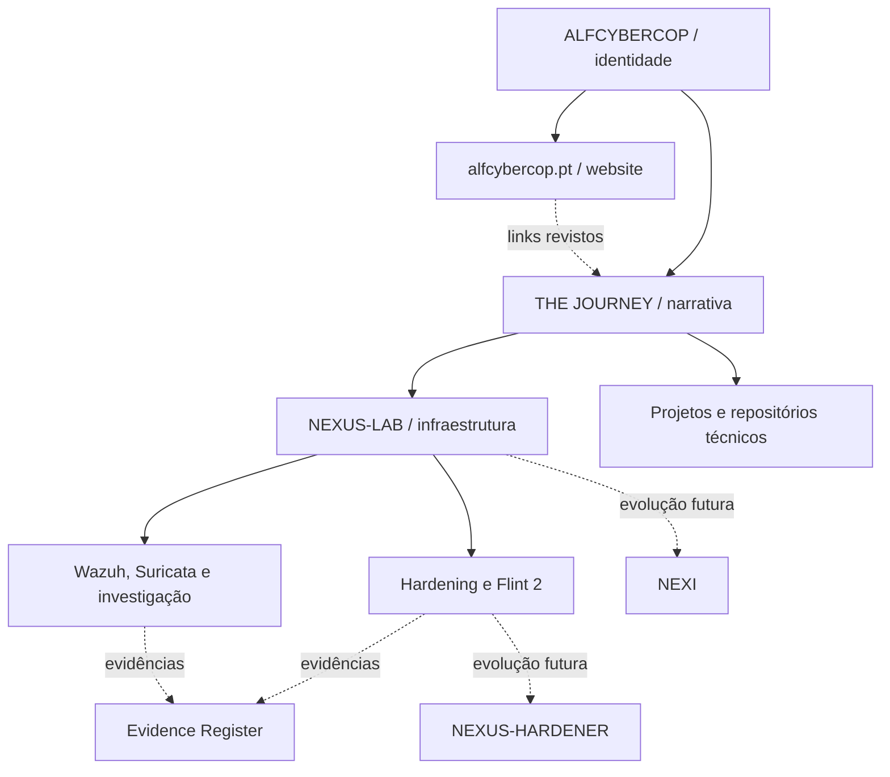

# 🧩 INTEGRATIONS

**Uma história. Vários projetos. Evidência rastreável.**

[🏠 ECOSYSTEM](../README.md) · [🧪 PROJETOS](../PROJECTS/README.md) · [📁 EVIDÊNCIAS](../EVIDENCE/EVIDENCE-REGISTER.md)

---

O **ALFCYBERCOP ECOSYSTEM** é o **repositório-mãe narrativo**. Não pretende copiar integralmente o código de todas as iniciativas para um monorepo. O seu trabalho é ligar **identidade pública, história, projetos independentes, documentação e provas** de forma verificável.

## 🗺️ Como as peças se relacionam

*Esquema editorial: ligações e planos não implicam integrações técnicas já implementadas.*

## 🧱 As cinco camadas

| Camada | Responsabilidade | Referência |
|:--|:--|:--|
| **01 · Identidade** | Perfil e website como pontos públicos de entrada | [GitHub](https://github.com/AlfCyberCop) · [Website](../PROJECTS/WEBSITE.md) |
| **02 · Narrativa** | Contexto, datas, decisões e aprendizagem | [THE JOURNEY](../THE-JOURNEY/README.md) |
| **03 · Engenharia** | Fichas técnicas e ligação a projetos independentes | [Catálogo](../PROJECTS/README.md) |
| **04 · Evidências** | O que foi observado, fontes e limites | [Registo](../EVIDENCE/EVIDENCE-REGISTER.md) |
| **05 · Automação** | Índices, catálogos, verificações e futuras interfaces | [Roadmap](../ROADMAP.md) |

## ✅ Regras de integração

- **Não inventar URLs:** um repositório técnico só ganha link após confirmação.
- **Não duplicar segredos ou backups:** os originais sensíveis permanecem fora do Git.
- **Declarar o estado real:** `confirmado`, `reconstruído`, `protótipo` ou `planeado`.
- **Ligar prova e limite:** um resultado técnico precisa de contexto, data e interpretação.
- **Preservar a independência:** o repositório narrativo aponta para código e documentação próprios sem fingir que os substitui.

## 🔗 Registos

[URLs verificadas e pendentes](LINK-REGISTRY.md) · [Catálogo estruturado](project-catalog.csv) · [Política de publicação](../EVIDENCE/PUBLICATION-POLICY.md)

---

[← Voltar ao ECOSYSTEM](../README.md)
