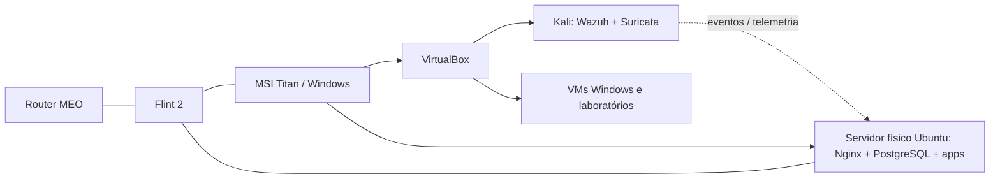

# NEXUS-LAB — A infraestrutura que tornou as perguntas testáveis

**Problema inicial:** como estudar redes, sistemas, aplicações e cibersegurança fora de um laboratório académico fechado, sem depender apenas de screenshots e tutoriais?

**Resposta de engenharia:** um ambiente próprio, evolutivo e documentado, que inclui um servidor físico Ubuntu, um MSI Titan como posto de trabalho e anfitrião de VMs, Kali e convidados Windows, aplicações e serviços reais.

*Esquema lógico editorial, não um mapa exato das rotas nem prova de IPS em linha. A topologia mudou ao longo do tempo.*

## Linha de evolução

1. Escolha e preparação do hardware disponível.
2. Linux, SSH, Nginx, PostgreSQL e interfaces de gestão.
3. VirtualBox, Kali, clientes Windows e experiências controladas.
4. Monitorização e deteção: Wazuh e Suricata IDS.
5. Hardening e controlo da rede com Flint 2.
6. Próxima geração: hardware dedicado e isolamento mais estável.

## O que comprovar

- Esquema por versão de arquitetura, sem publicar endereços e credenciais reais.
- Logs sanitizados de serviços, configurações de exemplo e testes de integridade.
- Decisões e incidências relevantes [em vez de uma lista de aplicações instaladas](../THE-JOURNEY/docs/02-first-lab.md).

[Hardening + Flint 2](HARDENING-FLINT2.md) · [Wazuh + Suricata](WAZUH-SURICATA.md) · [Roadmap](../ROADMAP.md)
