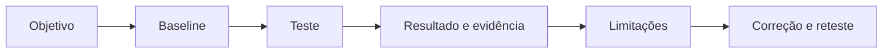

# 🧪 PROJECTS / ENGINEERING

**Da infraestrutura à deteção. Da hipótese ao reteste.**

[🏠 ECOSYSTEM](../README.md) · [🌌 THE JOURNEY](../THE-JOURNEY/README.md) · [📍 ROADMAP](../ROADMAP.md)

---

Este é o mapa dos projetos técnicos do **ALFCYBERCOP ECOSYSTEM**. Cada ficha separa **o que foi observado** do que está **em desenvolvimento ou planeado**. Um serviço ativo não significa que toda a arquitetura foi validada; documentação pronta não significa produto final.

## 🖥️ Infraestrutura e rede

| Projeto | O que resolve | Situação documentada |
|:--|:--|:--|
| **[NEXUS-LAB](NEXUS-LAB.md)** | Linux, VirtualBox, Nginx, PostgreSQL, redes e ambientes de teste | 🟢 Infraestrutura operacional e em evolução |
| **[Hardening + Flint 2](HARDENING-FLINT2.md)** | Proteção do host, controlo da rede e troubleshooting | 🟢 Hardening registado · 🟠 Wi-Fi em investigação |
| **[Website / alfcybercop.pt](WEBSITE.md)** | Identidade digital, domínio, HTTPS e publicação | 🟠 Infraestrutura web documentada; conteúdo em construção |

## 🔎 Deteção e investigação

| Projeto | O que explora | Situação documentada |
|:--|:--|:--|
| **[Wazuh + Suricata](WAZUH-SURICATA.md)** | SIEM, eventos, IDS, JSON e validação de alertas | 🟢 Capturas e testes específicos demonstrados · 🟠 IPS por validar |
| **[NEXUS-WEBSEC LAB](NEXUS-WEBSEC.md)** | SSTI, SSRF, desserialização insegura e correções | 🟠 Laboratórios e documentação em evolução |

## 🧰 Ferramentas em desenvolvimento ou planeadas

| Projeto | Direção | Estado |
|:--|:--|:--|
| **[NEXUS-HARDENER](NEXUS-HARDENER.md)** | Pré-check, módulos, backup, rollback e evidência | 🔵 Produto planeado |
| **[NEXI](NEXI.md)** | Assistente local, PostgreSQL e integração autenticada | 🟠 Beta histórica; recuperação/validação pendentes |

Legenda: 🟢 capacidade ou resultado específico documentado · 🟠 parcial/em investigação · 🔵 planeado. Não são certificações nem classificações de segurança.

## 🎯 Três casos que mostram o método

| Caso | O que aprendemos | Abrir |
|:--|:--|:--|
| **Lynis: melhoria e regressões** | Medir sem confundir pontuação com segurança; explicar diferenças entre versões e resolver incidentes | [Hardening](HARDENING-FLINT2.md) |
| **4 eventos ICMP → 4 recebidos** | Distinguir a geração do evento da sua receção e correlação no Wazuh | [Detection](WAZUH-SURICATA.md) |
| **Flint 2 e Wi-Fi inesperadamente pior** | Uma arquitetura defensiva tem de respeitar a experiência real de utilização | [Rede](HARDENING-FLINT2.md) |

## 📐 Como documentamos

Os projetos ligam-se ao **[Security Research](../SECURITY-RESEARCH/README.md)**, ao **[registo de evidências](../EVIDENCE/EVIDENCE-REGISTER.md)** e ao **[mapa de integrações](../INTEGRATIONS/README.md)**. O código técnico independente só é referenciado por URL depois de confirmado no [registo de ligações](../INTEGRATIONS/LINK-REGISTRY.md).

---

[← Voltar ao ECOSYSTEM](../README.md) · [Continuar em THE JOURNEY →](../THE-JOURNEY/README.md)
