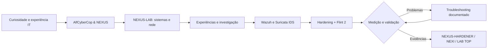

# ALFCYBERCOP ECOSYSTEM 🛡️

### *Beyond Tools. Into Understanding.*

> **Não é sobre instalar ferramentas. É sobre compreender sistemas, provocar as perguntas certas, detetar problemas e demonstrar as soluções.**

**Uma viagem de engenharia: curiosidade → laboratório → experiências controladas → deteção → correção → evidência → melhoria.**

Este não é um catálogo de software. É o registo da construção de um ecossistema de cibersegurança liderado por **ALFCYBERCOP**, onde uma carreira em sistemas, desenvolvimento e operações se encontra com a investigação prática em segurança. A nossa história inclui decisões acertadas, erros, regressões, noites de troubleshooting e perguntas que ainda não têm resposta.

> **Estado deste repositório:** preparação editorial e técnica; não equivale a declarar todos os sistemas e integrações em produção.

## Entra por onde quiseres

| Camada | O que vais encontrar | Ler |
|---|---|---|
| **01 · The Journey** | As pessoas, as primeiras perguntas, o nascimento de NEXUS e os capítulos reais | [Começar a história](THE-JOURNEY/README.md) |
| **02 · NEXUS-LAB** | Máquinas, topologias, serviços e evolução do laboratório | [Explorar o LAB](PROJECTS/NEXUS-LAB.md) |
| **03 · Security Engineering** | Hardening, Flint 2 e o futuro NEXUS-HARDENER | [Engenharia](PROJECTS/HARDENING-FLINT2.md) |
| **04 · Security Research** | Testes autorizados, deteção, aplicações vulneráveis e forense | [Investigação](SECURITY-RESEARCH/README.md) |
| **05 · NEXI & The Team** | Colaboração com IA e a futura assistente local | [Conhecer a equipa](TEAM/README.md) |
| **06 · Evidence & Integration** | Provas, rastreabilidade, ligações entre projetos e website | [Integrações](INTEGRATIONS/README.md) |

## A jornada em marcos

[Timeline completa](THE-JOURNEY/TIMELINE.md) · [Roadmap técnico](ROADMAP.md) · [Registo de evidências](EVIDENCE/EVIDENCE-REGISTER.md)

## O trabalho invisível

**355–645 horas**: intervalo de esforço reconstruído de conversas, **não horas cronometradas**. As categorias podem sobrepor-se e os valores não devem ser usados como total de trabalho comprovado. [Metodologia](THE-JOURNEY/effort-method.md).

## Um exemplo de como pensamos

**O Wi-Fi do Flint 2 ficou pior em algumas divisões.** Não vamos apagar esse episódio. O servidor podia estar mais protegido e, simultaneamente, a experiência de rede da casa ter piorado. O que interessa é medir, diagnosticar, comparar opções e voltar a testar, sem fazer depender a Internet doméstica de uma VM Kali que pode estar desligada.

**O mesmo método aplica-se ao hardening:** o resultado final registado pelo Lynis foi **97/100**, mas a versão de Lynis e as opções de auditoria mudaram durante o processo. Não é uma percentagem de segurança nem uma comparação integralmente homogénea. O troubleshooting e a recuperação dos serviços fazem parte do resultado.

## Quem constrói

- **ALFCYBERCOP:** autor, operador e responsável pelas decisões, execuções e validações.
- **NEXUS · NEXIUS · NEDEX:** papéis de colaboração com IA para arquitetura, engenharia e pesquisa/testes. Não são pessoas nem agentes que operem autonomamente o laboratório.
- **NEXI:** projeto separado de assistente local; beta histórica, evolução por validar. [Ler](PROJECTS/NEXI.md).

**Website:** [alfcybercop.pt](https://www.alfcybercop.pt) · **GitHub:** [perfil AlfCyberCop](https://github.com/AlfCyberCop)

## Compromissos

1. As fontes distinguem **feito, testado, documentado, protótipo e planeado**.
2. Não publicar credenciais, backups, chaves, dados pessoais ou topologias internas completas.
3. Não copiar relatórios académicos integrais nem códigos vulneráveis sem revisão e contextualização.
4. A história explica **porquê**; os projetos descrevem **como**; as evidências demonstram **o que aconteceu**.

**Começar:** [THE JOURNEY](THE-JOURNEY/README.md) · [Catálogo de projetos](PROJECTS/README.md) · [Guia de instalação no Windows](docs/INSTALAR-EM-E.md)
