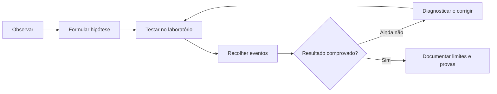
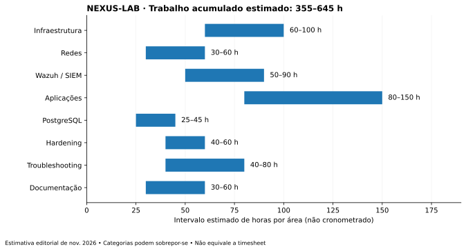

# 🛡️ ALFCYBERCOP ECOSYSTEM

### Beyond Tools. Into Understanding.

**Engenharia de sistemas × Cibersegurança × Investigação prática**

*Um laboratório real. Perguntas difíceis. Erros documentados. Resultados com evidência.*

[**🌌 THE JOURNEY**](THE-JOURNEY/README.md) · [**🧪 PROJETOS**](PROJECTS/README.md) · [**🔎 SECURITY RESEARCH**](SECURITY-RESEARCH/README.md) · [**🤝 EQUIPA**](TEAM/README.md)

---

> **«Não é sobre instalar ferramentas. É sobre compreender sistemas, provocar as perguntas certas, detetar problemas e demonstrar as soluções.»**

O **ALFCYBERCOP ECOSYSTEM** reúne a evolução de um laboratório de cibersegurança construído a partir de experiência em **sistemas, desenvolvimento e operações**. Não é um catálogo de tecnologias: é uma história de decisões, experiências controladas, troubleshooting e validações.

**O princípio:** *a história explica porquê; os projetos descrevem como; as evidências mostram o que foi observado.*

## ⚡ O que já conseguimos observar

| Área | Resultado documentado | Limite importante |
|:--|:--|:--|
| **Linux Hardening** | Evolução de registos Lynis de **59/100 (3.0.7)** até **97/100 (3.1.7)** | Versões e testes diferentes: **não** significa «97% seguro» nem comparação homogénea |
| **Suricata IDS** | **8.0.8**, **53 603 regras** carregadas e captura HTTP no laboratório | Não demonstra IPS em linha nem cobertura da rede inteira |
| **Wazuh** | Num teste ICMP específico, **4 eventos observados e 4 recebidos** | Resultado daquele cenário, não garantia geral de deteção |
| **Flint 2** | Integração do router na arquitetura e investigação da rede | Cobertura/desempenho Wi-Fi ainda com problemas a resolver |

**Ler os casos:** [Hardening + Flint 2](PROJECTS/HARDENING-FLINT2.md) · [Wazuh + Suricata](PROJECTS/WAZUH-SURICATA.md) · [NEXUS-LAB](PROJECTS/NEXUS-LAB.md)

## 🧭 Escolhe por onde entrar

| | Percurso | O que encontras |
|:--:|:--|:--|
| 🌌 | **[THE JOURNEY](THE-JOURNEY/README.md)** | Capítulos, marcos, dúvidas, regressões e a origem de NEXUS |
| 🖥️ | **[NEXUS-LAB](PROJECTS/NEXUS-LAB.md)** | Infraestrutura, virtualização, serviços e escolhas de arquitetura |
| 🛡️ | **[SECURITY ENGINEERING](PROJECTS/README.md)** | Hardening, router, IDS, deteção e ferramentas planeadas |
| 🔬 | **[SECURITY RESEARCH](SECURITY-RESEARCH/README.md)** | AppSec, SOC, forense, IR e metodologia experimental |
| 🤝 | **[THE TEAM](TEAM/README.md)** | ALFCYBERCOP, colaboração com IA e o projeto NEXI |
| 🧩 | **[INTEGRATIONS](INTEGRATIONS/README.md)** | Relação entre website, repositórios técnicos e evidências |

## 🔄 Do problema à evidência

É assim que tratamos uma regressão do Lynis, um alerta Wazuh, um comportamento inesperado do Suricata ou uma divisão da casa onde o Wi-Fi piorou. **Os problemas fazem parte do portefólio.**

## 📖 A jornada também tem horas invisíveis

**355–645 horas** é um intervalo **reconstruído historicamente**, não tempo cronometrado. As categorias podem sobrepor-se e os valores não são horas certificadas. [Como foi estimado](THE-JOURNEY/effort-method.md).

## 🚧 O que está em construção

- **[NEXUS-HARDENER](PROJECTS/NEXUS-HARDENER.md)** — futura ferramenta modular de hardening com pré-validação, backups, testes e rollback; **não declarada concluída**.
- **[NEXI](PROJECTS/NEXI.md)** — assistente local com beta histórica; recuperação e integração por validar.
- **[NEXUS-LAB TOP](ROADMAP.md)** — evolução da virtualização e da arquitetura defensiva.
- **[alfcybercop.pt](PROJECTS/WEBSITE.md)** — identidade digital e website em desenvolvimento.

## 👤 Quem está por trás

**ALFCYBERCOP** é o autor e responsável pelas decisões, configurações e testes. **NEXUS, NEXIUS e NEDEX** são papéis de colaboração com IA; não são operadores autónomos do laboratório. [Conhecer a equipa](TEAM/README.md).

Este repositório é **documentação viva**: distinguimos *confirmado*, *reconstruído*, *protótipo* e *planeado*. Evidências públicas são selecionadas e sanitizadas. [Política de publicação](EVIDENCE/PUBLICATION-POLICY.md).

---

**[🌌 Começar a história](THE-JOURNEY/README.md) · [🧪 Explorar projetos](PROJECTS/README.md) · [🗓️ Consultar o roadmap](ROADMAP.md)**

[GitHub · AlfCyberCop](https://github.com/AlfCyberCop) · [Website · alfcybercop.pt](https://www.alfcybercop.pt)

*Beyond tools. Into understanding.*

