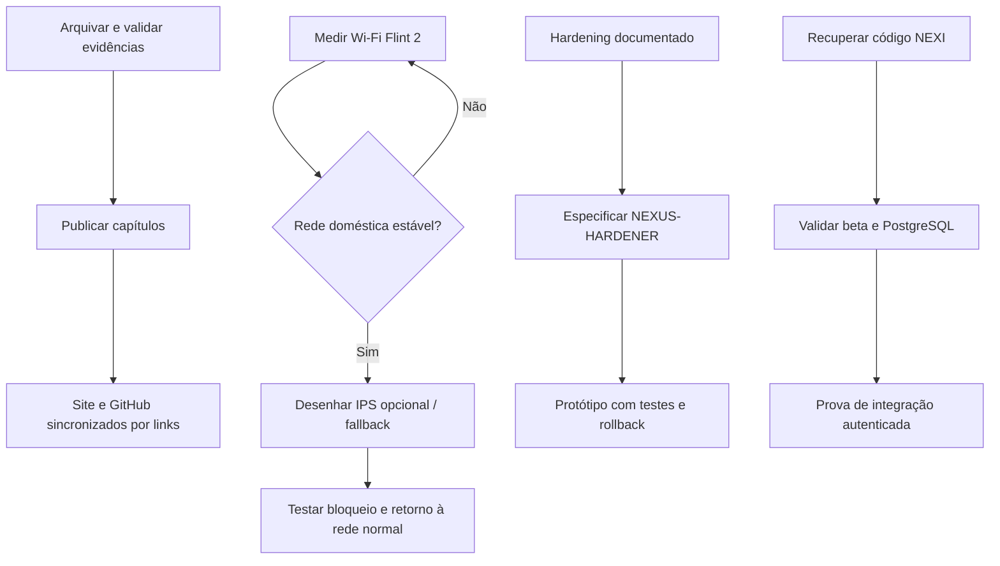

# Roadmap — ALFCYBERCOP ECOSYSTEM

Não é um cronograma fictício: é um **mapa de trabalho e dependências**. A cronologia histórica está em [THE-JOURNEY/TIMELINE.md](THE-JOURNEY/TIMELINE.md).

| Fase | Objetivo | Critério para encerrar | Estado |
|---|---|---|---|
| **A — Arquivo** | Cruzar conversas com logs, prints, relatórios e commits | Marcos com data, fonte e nível de confiança | Em curso |
| **B — Identidade** | README e navegação ALFCYBERCOP | Página inicial revista e aprovada | Rascunho |
| **C — NEXUS-LAB** | Arquiteturas por período e serviços | Diagramas sanitizados + decisões documentadas | Em curso |
| **D — Hardening + Flint 2** | Contar juntos proteção do host e reconfiguração da rede | Medições Wi-Fi, incidentes, ações e validações | Em curso |
| **E — Segurança e deteção** | Casos de testes, Wazuh, Suricata, evidência | Recolha e alerta reproduzível, limites explicados | Parcial |
| **F — NEXUS-HARDENER** | Reutilizar o hardening como ferramenta | Pré-check, backups, rollback, testes, logs, documentação | Planeado |
| **G — NEXI Reborn** | Recuperar beta, store, bridge e contexto | Teste de ponta a ponta com autenticidade e auditoria | Planeado |
| **H — Integração pública** | Ligar site, GitHub e índices de evidências | Links públicos revistos; dados privados excluídos | Planeado |
| **I — LAB TOP** | Virtualização dedicada, proteção 24/7 | Hardware e desenho aprovados; migração testada | Visão futura |

## As dependências técnicas

**Regra:** o MSI/Kali pode estar desligado sem cortar a Internet de casa. IDS passivo não é IPS em linha; um serviço `active` não equivale a bloqueio comprovado.
