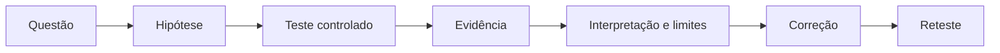

# 🔬 SECURITY RESEARCH

**Explorar. Observar. Explicar. Corrigir. Retestar.**

[🏠 ECOSYSTEM](../README.md) · [🧪 PROJETOS](../PROJECTS/README.md) · [📁 EVIDÊNCIAS](../EVIDENCE/EVIDENCE-REGISTER.md)

---

Nesta área reunimos investigações **controladas e autorizadas**, feitas em laboratórios, aplicações intencionalmente vulneráveis e cenários de ensino. O objetivo não é colecionar payloads ou ferramentas: é **mostrar como chegámos a uma conclusão e até onde a prova permite ir**.

## 🧩 Linhas de investigação

| Área | Pergunta de investigação | O que procuramos documentar |
|:--|:--|:--|
| **Application Security** | Porque ocorre uma SSTI, SSRF ou desserialização insegura? | Hipótese, reprodução, causa, correção e reteste |
| **Network Security / IDS** | O sensor vê realmente o tráfego relevante? | Captura, contexto, limites de visibilidade e contadores |
| **SIEM / Detection Engineering** | O evento chega e é interpretável? | Origem, regra, recolha, consulta e confirmação |
| **Incident Response** | Que hipóteses explicam o comportamento observado? | Timeline, artefactos, análise e limites da conclusão |
| **Digital Forensics** | A análise pode ser reproduzida? | Hashes, metodologia, resultados e cadeia de evidência |
| **File Integrity** | Uma alteração controlada foi detetada? | Baseline, mudança, evento ou ausência de alerta |

## 🔁 Método de investigação

**Um teste falhado também conta:** ajuda a eliminar hipóteses, perceber limitações da ferramenta e orientar a investigação seguinte. Sem prova, não há afirmação de sucesso.

## 🗂️ Casos relacionados

- **[NEXUS-WEBSEC LAB](../PROJECTS/NEXUS-WEBSEC.md):** investigação e correção de vulnerabilidades web, incluindo SSTI, SSRF e desserialização insegura.
- **[Wazuh + Suricata](../PROJECTS/WAZUH-SURICATA.md):** eventos observados, IDS, `eve.json` e validações específicas.
- **[Hardening + Flint 2](../PROJECTS/HARDENING-FLINT2.md):** resultados defensivos e troubleshooting que beneficiam de retestes documentados.

## 🔐 Política de evidência

Logs, prints, configurações e capturas só são publicados após revisão e sanitização. Ficheiros privados, credenciais e artefactos brutos ficam fora do repositório público. Uma menção a uma prova histórica não significa que essa prova já esteja anexada e revista.

[Modelo de estudo de caso](../templates/CASE-STUDY.md) · [Política de publicação](../EVIDENCE/PUBLICATION-POLICY.md) · [Registo de evidências](../EVIDENCE/EVIDENCE-REGISTER.md)

---

[← Voltar ao ECOSYSTEM](../README.md)
