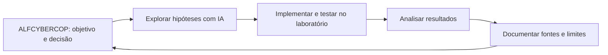

# 🤝 MEET THE NEXUS TEAM

**Human-led engineering. AI-assisted thinking.**

[🏠 ECOSYSTEM](../README.md) · [🌌 THE JOURNEY](../THE-JOURNEY/README.md) · [🧪 PROJETOS](../PROJECTS/README.md)

---

## 👤 O autor e operador

**ALFCYBERCOP** decide, desenha, executa, valida e documenta o trabalho. Os projetos cruzam a experiência em **Unix/Linux, desenvolvimento e operações** com experiências controladas de **cibersegurança, deteção e hardening**.

O resto da equipa são **papéis de colaboração com IA** para discutir hipóteses, rever alternativas e organizar documentação. **Não são pessoas nem agentes autónomos com acesso operacional ao laboratório.**

## 🧠 Papéis de colaboração

| Identidade | Foco | Pergunta típica |
|:--|:--|:--|
| **NEXUS** 🧭 | Arquitetura, integração e visão de sistemas | *Como é que as peças se ligam?* |
| **NEXIUS** 🛠️ | Engenharia, desenvolvimento e documentação | *Como construímos e validamos isto?* |
| **NEDEX** 🔎 | Pesquisa, hipóteses, testes e evidência | *O que conseguimos realmente provar?* |
| **NEXI** 🌱 | Projeto de assistente local em recuperação | *Que funcionalidades podem ser demonstradas num protótipo?* |

> **Nota:** NEXI é **software em desenvolvimento**, não uma quarta IA independente já em produção. A sua beta histórica e integração ainda necessitam de revisão e reteste.

## 🔁 Como trabalhamos

O histórico inclui conversas com contexto limitado, decisões reconstruídas e correções feitas depois de novos testes. Não escondemos essas limitações nem atribuímos resultados a operadores inexistentes.

## 📖 Explora a história

[Como nasceu NEXUS](../THE-JOURNEY/docs/01-origins.md) · [NEXI Reborn](../PROJECTS/NEXI.md) · [Guia editorial](../docs/EDITORIAL.md)

---

[← Voltar ao ECOSYSTEM](../README.md)
