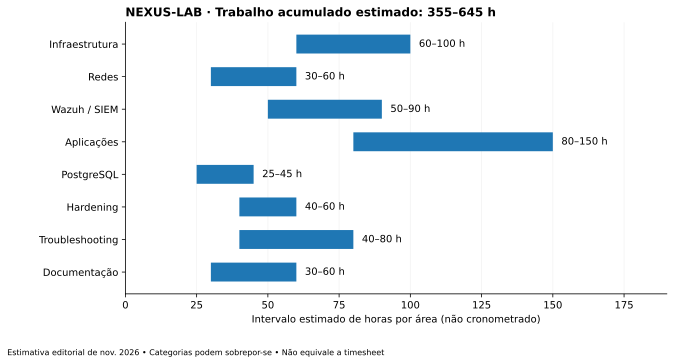

# THE JOURNEY — ALFCYBERCOP 🛡️

### *Beyond Tools. Into Understanding.*

> **Não é sobre instalar ferramentas. É sobre compreender sistemas, provocar as perguntas certas, detetar problemas e demonstrar as soluções.**

**Uma história real de curiosidade, sistemas, redes, ataques controlados, deteção e engenharia.**

Não comecei com um SOC pronto, uma arquitetura ideal ou um catálogo de certificações. Comecei com perguntas, com experiência de muitos anos em IT e com uma decisão: **deixar de estudar apenas o que as ferramentas fazem e passar a descobrir como os sistemas se comportam**.

Dessa vontade nasceu um laboratório próprio. Primeiro uma ideia. Depois máquinas, Linux, bases de dados, redes, VMs, aplicações, testes e incidentes. Com o tempo, o laboratório tornou-se um lugar onde cada erro podia ser investigado e cada melhoria precisava de provas.

Esta página é a porta de entrada. A história completa está dividida em capítulos; as configurações, relatórios, testes e evidências ficam ligados a cada episódio.

**[Percorrer a timeline](TIMELINE.md) · [Ver o roadmap](ROADMAP.md) · [Consultar as evidências](EVIDENCE-REGISTER.md)**

---

## O momento em que tudo começou

**26 de maio de 2026** — ficou expressa a intenção de **aplicar no laboratório o que aprendia**. Uma frase simples, mas que mudou o tipo de perguntas: «E se eu montar isto? E se provocar um evento? Como sei que foi detetado? E como demonstro a correção?»

**4 de julho de 2026** — em conversas sobre ferramentas de documentação e infraestrutura, emergiu o nome **NEXUS**. Uma resposta que merece ser preservada na nossa memória editorial: «AlfCyberCop & Nexus. Comprado.» *(citação histórica a confrontar com a conversa original antes de publicação definitiva)*.

**5 de julho de 2026** — ficou registada a frase «Agora estou em PLUS.» Não é uma prova da data de adesão, mas é um marco verificável na forma como a colaboração com IA passou a acompanhar o trabalho. Naquela fase, a continuidade de memória ainda era limitada: muitas ideias tinham de ser reconstruídas entre conversas. Esse esforço também faz parte da história.

Depois veio a necessidade inevitável: **construir algo que existisse fora da conversa**.

## A viagem, em seis capítulos

| Episódio | O que aconteceu | Explorar |
|---|---|---|
| **01 · Da curiosidade à decisão** | A identidade ALFCYBERCOP, a vontade de experimentar e o aparecimento de NEXUS | [Ler](docs/01-origins.md) |
| **02 · O laboratório ganha corpo** | Ubuntu, MSI Titan, VirtualBox, Kali, Windows, rede e serviços; os primeiros obstáculos | [Ler](docs/02-first-lab.md) |
| **03 · Atacar, observar, detetar** | Exercícios controlados, Wazuh, análise de eventos, Suricata e casos web | [Ler](docs/03-detection.md) |
| **04 · Hardening encontra Flint 2** | A proteção do servidor cruza-se com o controlo da rede — e o Wi-Fi não colabora | [Ler](docs/04-hardening-flint2.md) |
| **05 · NEXI: uma promessa que regressa** | Beta local, PostgreSQL, bridge experimental e plano para recuperar o projeto | [Ler](docs/05-nexi.md) |
| **06 · O que ainda falta construir** | IPS opcional, laboratório dedicado, automação e NEXUS Security Suite | [Roadmap](ROADMAP.md) |

## Os momentos em que deixámos de acreditar e começámos a medir

- **Agosto:** o Wazuh registou um evento local de `sudo`, com regra e hora identificadas. Deixou de ser apenas uma instalação; passou a existir uma deteção observável.
- **Novembro, Kali:** Suricata 8.0.8, 53 603 regras ativas, captura em `eth1` e uma transação HTTP registada em `eve.json`. **Captura IDS comprovada; IPS de rede inteira não demonstrado.**
- **Novembro, NEXUS-LAB:** um teste ICMP do MSI gerou **4 eventos observados pelo sensor e 4 recebidos no Wazuh**. Esta prova de ponta a ponta é diferente da primeira captura HTTP na Kali.
- **Hardening:** mudanças, regressões, reparações e uma pontuação Lynis que chegou a **97/100** nos registos do projeto. O número interessa; o processo que levou até lá interessa mais.
- **Flint 2:** o router trouxe controlo, mas também problemas de cobertura Wi-Fi. O episódio não fica «resolvido» só porque a arquitetura no papel é bonita.

## O trabalho invisível por trás dos resultados

**355–645 horas** é uma **estimativa histórica**, reconstruída por categorias de atividade; não resulta de um cronómetro, timesheets ou extração automática de conversas. Os intervalos foram somados como ordem de grandeza e **podem sobrepor-se entre categorias** (por exemplo, troubleshooting durante hardening). Nunca devem ser apresentados como horas certificadas.

## O ALFCYBERCOP e a equipa

**ALFCYBERCOP** é a identidade técnica do autor e de quem decide, configura, testa e assume a responsabilidade. O projeto combina experiência anterior em Oracle, Unix/Linux, operações e desenvolvimento com formação e investigação prática em cibersegurança.

**NEXUS, NEXIUS e NEDEX** são personas de colaboração com IA usadas para explorar alternativas, desenhar sistemas, discutir hipóteses e documentar. **NEXI** é diferente: um **projeto de assistente local**, com protótipos antigos, ainda não um produto pronto. O contributo de IA é apresentado com transparência; os resultados e a autoria técnica não são atribuídos a agentes autónomos inexistentes.

## Um website, um laboratório, provas públicas

- **[alfcybercop.pt](https://www.alfcybercop.pt)** — a casa digital da identidade e dos projetos; a evolução do website também faz parte da jornada.
- **[GitHub / AlfCyberCop](https://github.com/AlfCyberCop)** — código, documentação, testes, decisões e relatórios selecionados.
- **NEXUS-LAB** — a infraestrutura e os ambientes controlados que tornam as experiências reproduzíveis.

**Princípio editorial:** *a história explica o porquê; o código mostra o como; a evidência demonstra o que realmente aconteceu.*

> **Estado:** rascunho editorial v2, preparado para revisão. Não implica que o repositório tenha sido publicado ou que os episódios em curso estejam concluídos. Os endereços privados, credenciais, segredos e configurações sensíveis são excluídos das evidências públicas.

[Regressar ao ECOSYSTEM](../README.md) · [Projetos](../PROJECTS/README.md) · [Equipa](../TEAM/README.md)
