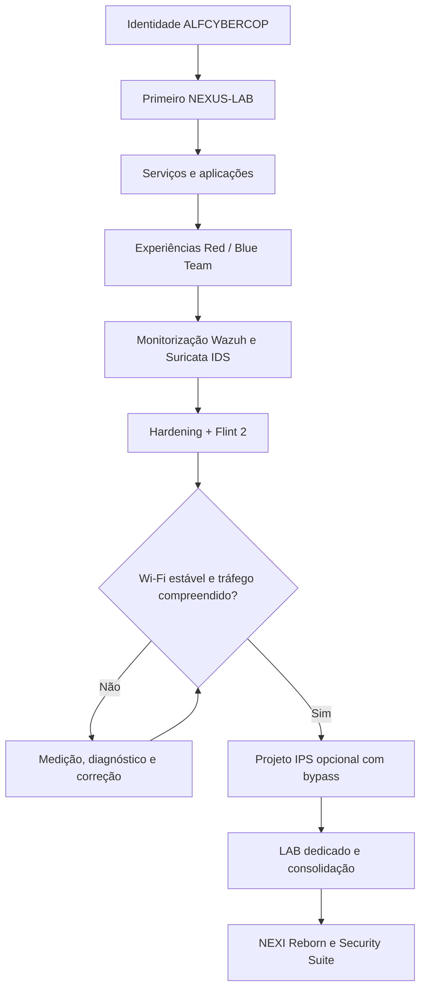

# Roadmap de engenharia — o que vem a seguir

Um roadmap não reescreve a história: marca as dependências, os testes e os critérios que faltam cumprir.

| Prioridade | Trabalho | Como sabemos que ficou feito? | Estado editorial |
|---|---|---|---|
| P0 | Reunir provas cronológicas | Cada data importante associada a conversa, log ou commit original | Em construção |
| P0 | Flint 2 e Wi-Fi | Mapa de cobertura, medidas repetíveis antes/depois, funcionamento doméstico sem Kali | Aberto |
| P0 | Hardening + rede como episódio conjunto | Linha temporal de decisões, regressões Lynis, incidentes e resolução real | Documentação em revisão |
| P1 | Suricata e Wazuh — demonstração ponta a ponta | Anexar e explicar o teste 4/4 ICMP; reproduzir em cenário definido | Teste anterior documentado; pacote editorial pendente |
| P1 | Avaliar IPS em linha **opcional** | Tráfego realmente passa pelo ponto de inspeção; testes de bloqueio; retorno seguro ao funcionamento normal | Planeado |
| P1 | Ligar GitHub e alfcybercop.pt | Página inicial, projetos selecionados, navegação e links validados | Planeado |
| P2 | NEXUS-HARDENER | Ferramenta modular com auditoria, pré-check, backups, rollback, teste e relatório | Projeto futuro |
| P2 | NEXI Reborn | Recuperar a beta, validar código, autenticação e memória; demonstrar integração mínima | Projeto futuro |
| P2 | Proxmox / LAB dedicado | Plano de migração, capacidade, segurança e continuidade | Projeto futuro |
| P2 | NEXUS Security Suite | Hardener + Auditor + Sentinela com especificações, testes e evidências | Conceito |

**Condição inegociável:** desligar o MSI/Kali não pode deixar a casa sem Internet. O Flint 2 continua gateway; a inspeção na VM só pode ser incluída após desenho, validação de tráfego e mecanismo de desativação seguro.

## O padrão de trabalho

**PERGUNTA → HIPÓTESE → BASELINE → TESTE → EVIDÊNCIA → DIAGNÓSTICO → CORREÇÃO → RETESTE → LIÇÃO.**

As decisões de segurança são publicadas apenas com o contexto necessário, sem segredos, credenciais ou detalhes que exponham a rede doméstica.
